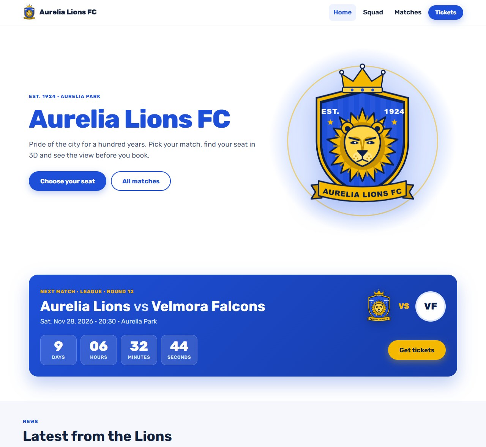
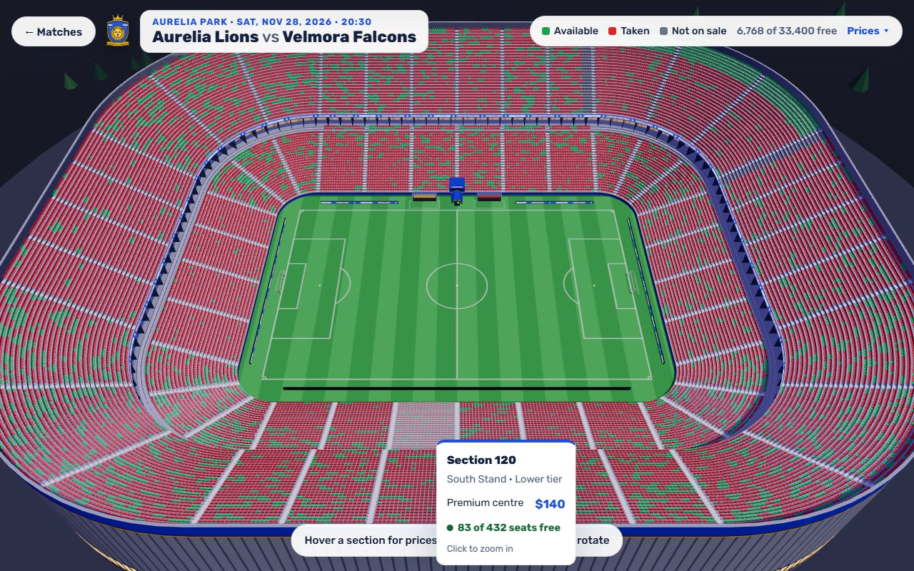
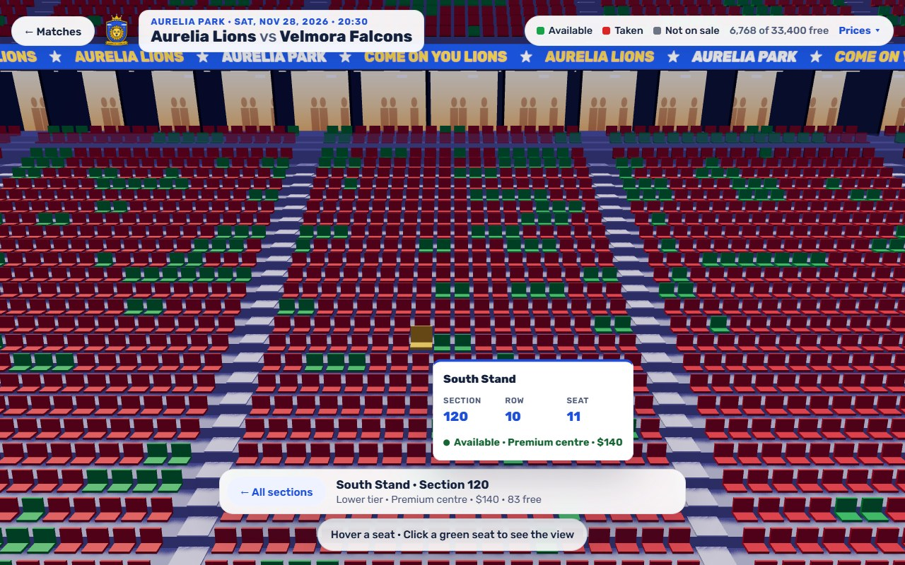
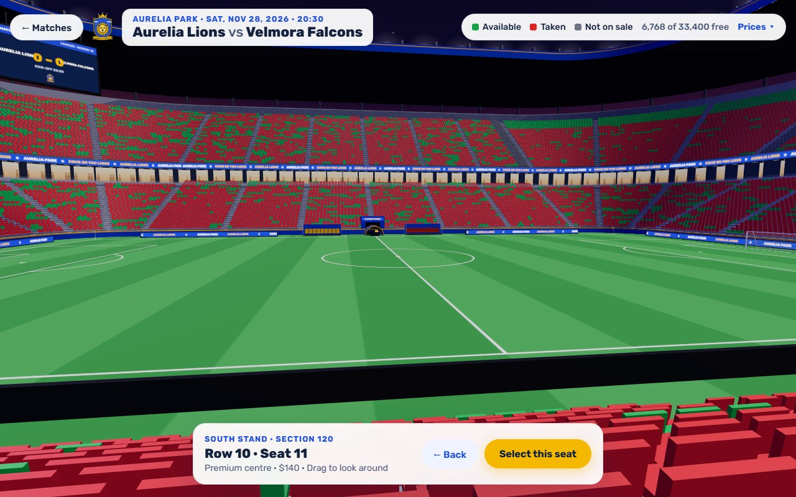
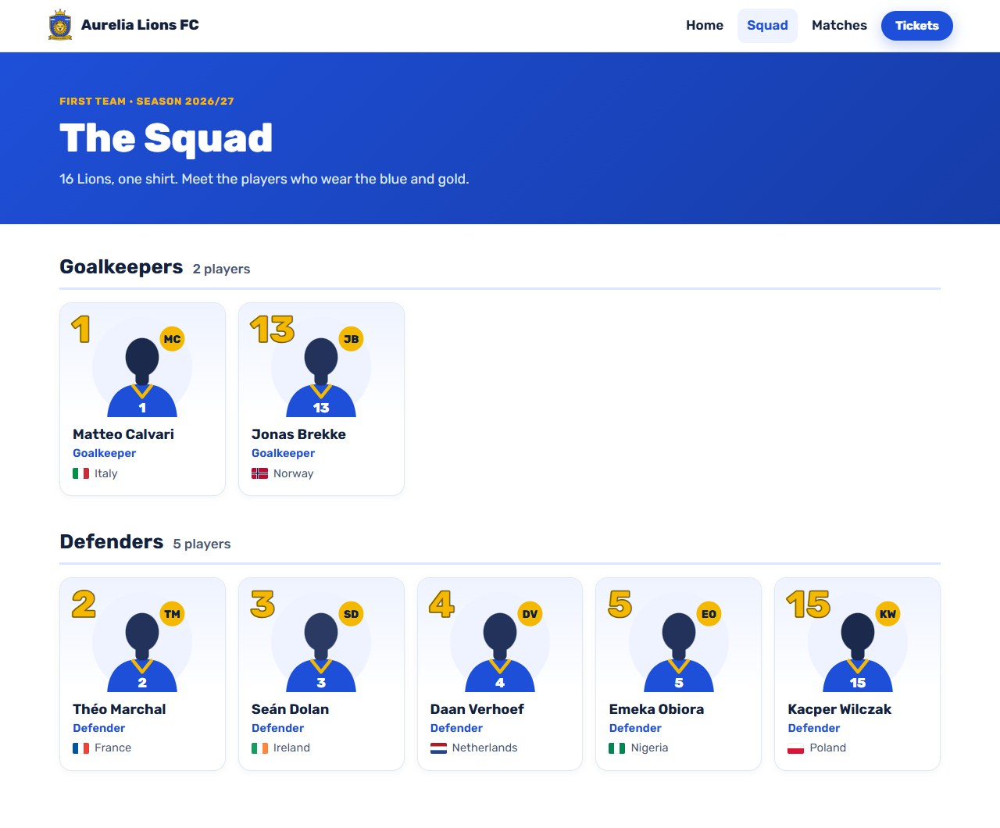
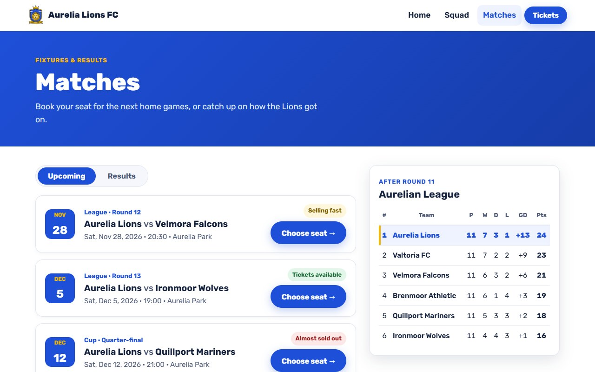

<p align="center">
  
</p>

<h1 align="center">Aurelia Lions FC</h1>

<p align="center">
  A football club website with an interactive 3D stadium: pick a match, explore 33,400 seats, and see the view from your seat before you book.
</p>

<h2 align="center">
  <a href="https://arzhazima.github.io/aurelia-lions-fc/">▶ Live Demo</a>
</h2>

<p align="center">
  <a href="https://arzhazima.github.io/aurelia-lions-fc/#/stadium/match-1">Open the 3D stadium</a> ·
  <a href="https://arzhazima.github.io/aurelia-lions-fc/#/squad">Squad</a> ·
  <a href="https://arzhazima.github.io/aurelia-lions-fc/#/matches">Matches</a>
</p>

---

## Screenshots

| Home | 3D stadium overview |
| :---: | :---: |
|  |  |
| **Zoomed into a section** | **View from the chosen seat** |
|  |  |
| **Squad** | **Matches & league table** |
|  |  |

## Features

- **3D stadium seat picker:** a two-tier bowl with 33,400 individual seats, a VIP level, roof, floodlights, video screens, tunnel and dugouts
- **Section → seat → view:** hover a section for price and availability, zoom in, pick a seat, then fly down to see the pitch from it
- **Realistic availability per match:** season-ticket blocks, an away section with a segregation buffer, group bookings, demand per match
- **Prices by category:** VIP, premium centre, central, corner, behind the goal, away
- **Demo booking flow:** summary and confirmation, no real payment
- **Club website:** home with a live countdown to the next match, news, squad, fixtures, results and league table
- **Responsive and accessible:** works on phones, keyboard-friendly tabs, readable contrast, respects "reduce motion"

## Technical highlights

- **33,400 seats with `InstancedMesh`.** Each seat is its own object with its own position and color, but they are drawn in about 18 batches (one per tier and side of the bowl). Batching keeps the frame rate smooth, and Three.js can skip whole batches that are off-screen.
- **Raycasting per seat.** The mouse ray returns the exact instance it hits, which maps to one seat (section, row, number). The concrete is tested too, so you can't pick a seat hidden behind it. In the overview, the hit point on the stand is converted back to "which section" with a little geometry, so hovering 33k seats stays cheap.
- **One shape, every row.** The bowl is a rounded rectangle; each row is the same shape pushed outward. Corners stay filled and stairs line up from the front row to the back. The same layout code is used by the browser and by the Node script that generates the seat data, so they always agree.
- **Camera fly animations with easing.** Flights follow a curved Bézier path with ease-in-out timing: overview → section → eye level in the seat, and back. In the seat view you can drag to look around, within limits.
- **Roof fade by mode.** The roof fades out completely while you choose seats, so it never hides the upper tier, and fades back in for the seat view so it still feels like a real stadium.
- **Click vs drag detection.** A press counts as a click only if the pointer moves less than 5 px, with no time limit. It works the same for mouse and touch. A pinch never counts as a click, and anything bigger rotates the view.
- **Seat availability data per match.** `scripts/generate-seats.js` writes one compact JSON file per match: one string per row, with `1` = sold, `0` = free, `x` = not on sale. Each file is loaded only when that match's stadium opens.

## Tech stack

**Vite** · **JavaScript** (no framework) · **Three.js** · **GitHub Actions** · **GitHub Pages**

## Run locally

```bash
npm install
npm run dev
```

Then open http://localhost:5173.

| Command | What it does |
| --- | --- |
| `npm run build` | Production build into `dist/` |
| `npm run seats` | Regenerate seat availability for every match |
| `npm run crest` | Regenerate the club crest SVG |

Every push to `main` builds and deploys the site to GitHub Pages automatically (`.github/workflows/deploy.yml`).

## Project structure

```
src/
├── main.js, router.js      Entry point and hash router (#/squad, #/stadium/match-1, …)
├── club.js                 Club name, stadium, crest, founding year
├── pages/                  home, squad, matches, stadium
├── components/             navbar, footer, cards, avatars, flags, fade-in
├── data/                   matches, players, results, league, news, seats/<match>.json
├── styles/                 main.css (theme, stadium UI), pages.css (site pages)
└── stadium/
    ├── index.js            Builds the scene, runs the loop, turns pointer input into hover/clicks
    ├── bowl/path.js        The bowl shape: rounded rectangle and offsets
    ├── bowl/layout.js      Every section, row and seat (shared with the seat-data script)
    ├── bowl/tiers.js       Concrete tiers, stairs, facade
    ├── seats.js            The InstancedMesh seats, colors, highlight and picking
    ├── camera.js           Intro, orbit, flights and look-around
    ├── roof.js, vip.js     Roof with floodlights; glass VIP boxes and LED ribbon
    ├── pitch.js, pitchside.js, screens.js   Pitch, boards, tunnel, dugouts, video screens
    └── ui.js               Tooltip, section bar, seat panel, booking dialog
scripts/
├── generate-seats.js       Realistic per-match seat availability
└── build-crests.js         Generates public/crest.svg
```

## Note

Aurelia Lions FC, its players, staff, opponents, league and Aurelia Park are **entirely fictional**. Any resemblance to real clubs or people is coincidental. No real tickets are sold.

---

<p align="center">Built with <a href="https://claude.com/claude-code">Claude Code</a>.</p>
